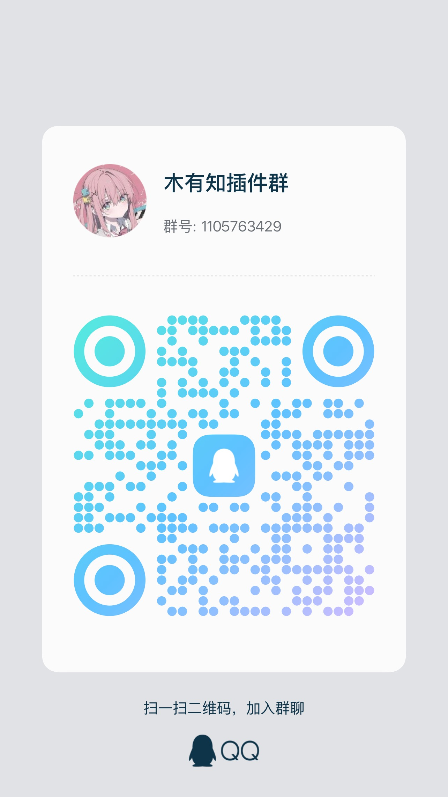

# 🎭 AstrBot TTS 情绪路由插件

[](https://github.com/muyouzhi6/astrbot_plugin_tts_emotion_router)
[](LICENSE)
[](https://www.python.org/)

面向中文场景的 TTS 插件：支持情绪路由、会话黑白名单策略、分段语音、概率语音，以及按需触发语音输出。

## ✨ 功能概览

- 支持多 TTS 服务商：`siliconflow` / `minimax` / `mimo` / `breeze`
- 情绪路由：支持 18 种中文语境情绪，并可映射不同音色和语速
- MiMo 支持情绪标签、唱歌、方言/角色等风格标签、导演模式和显式表演标签白名单
- Breeze Blue 支持 `instructions` 表演指导、`guidance_scale` 和按情绪自动追加中文指导
- 四类可独立配置策略（均支持 UMO 黑白名单）
  - 自动语音输出 `voice_output`
  - 文字+语音同时输出 `text_voice_output`
  - 分段语音输出 `segmented_output`
  - 概率语音输出 `probability_output`
- 可关闭所有强制自动语音，改为按需触发
  - 命令：`tts_say`
  - LLM 工具：`tts_speak`

## 🚀 快速开始

1. 在 AstrBot 插件市场安装并启用本插件。
2. 在 AstrBot 运行环境安装 `ffmpeg`。本机部署执行 `ffmpeg -version`；Docker 部署执行 `docker exec <AstrBot容器名> ffmpeg -version`，宿主机安装不等于容器已安装。
3. 在插件配置 → TTS 引擎选择服务商，填写 API Key、服务地址、模型和该模型支持的默认音色。SiliconFlow 的 `gpt-tts-pro` 与 CosyVoice 使用各自的音色 ID，不混用；克隆音色填写服务商返回的完整 ID。Breeze 的默认音色填写 `voc_` 开头的 voice_id。
4. 发送 `/tts_say 你好，请听清最后一个字：好。`，确认收到并播放完整语音。
5. 发送 `/tts_status` 查看状态；管理员可执行 `/tts_check`，对全部已配置服务商分别合成短音频并完整解码，会产生服务商费用。
6. 在目标会话执行 `/tts_on`。新安装采用空白名单、关闭概率随机化；已有显式配置保留。群聊开关由 AstrBot 管理员操作，私聊用户可管理自己的会话。

命令示例使用默认唤醒前缀 `/`；修改过 AstrBot 唤醒前缀时请替换。流式文字回复请关闭流式后使用自动语音，或调用 `/tts_say`。使用本插件自动语音时，关闭 AstrBot 设置中的内置自动 TTS，避免文字同发被二次合成。

手动命令与工具共用单次长度上限（默认 200 字，配置位置：功能策略 → LLM 工具 → 最大字数）；超长直接拒绝，不截断。每个实例最多同时合成 2 个手动任务，同一会话同时只能合成 1 个。

配置成功示例：

SiliconFlow 最小配置（在插件配置面板填写）：

| 字段 | 值 |
|------|----|
| 服务商 | `siliconflow` |
| 服务地址 | `https://api.siliconflow.cn/v1` |
| API Key | 在 [SiliconFlow 控制台](https://cloud.siliconflow.cn/account/ak) 创建并填写 |
| 模型 | `FunAudioLLM/CosyVoice2-0.5B` |
| 默认音色 | `FunAudioLLM/CosyVoice2-0.5B:alex` |
| 音频格式 | `wav` |
| 语速 | `1.0` |

音色与模型配对见 [官方语音合成文档](https://docs.siliconflow.cn/cn/docs/userguide/capabilities/text-to-speech)。使用预置音色无需上传音频，`voice_map` 可留空。


## ⚙️ 核心配置说明

### 1) UMO 与黑白名单

- 在聊天中发送 `/sid` 获取 UMO。
- 所有黑白名单字段都填写 UMO。
- 面板中的 `mode`：
  - `blacklist`：默认开启，命中黑名单关闭
  - `whitelist`：默认关闭，仅白名单开启

### 2) TTS 引擎

- `tts_engine.provider` 可选：
  - `siliconflow`
  - `minimax`
  - `mimo`
  - `breeze`

### 3) MiMo（已支持）

接口使用兼容 OpenAI Chat Completions 的 MiMo TTS 端点，支持：

- 预置音色：`冰糖` / `茉莉` / `苏打` / `白桦` / `Mia` / `Chloe` / `Milo` / `Dean`
- 18 种情绪标签：开心、悲伤、愤怒、恐惧、惊讶、兴奋、委屈、平静、冷漠、怅然、欣慰、无奈、愧疚、释然、嫉妒、厌倦、忐忑、动情
- 唱歌标签（仅 `mimo-v2.5-tts` 支持）
- MiMo 专属风格配置：整体语调、音色定位、人设腔调、方言、角色扮演
- MiMo 导演模式：通过不会被朗读的 user message 提供角色、场景、指导和上下文
- MiMo 表演标签白名单（默认关闭）：开启后可透传显式写出的 `（叹气）`、`（轻笑）`、`（哽咽）` 等括号标签；不会自动插入，展示文本会移除这些标签
- 对话临时指定风格/音色/导演指导，例如“用东北话说……”“用冰糖的音色说……”“语音导演：像深夜电话里疲惫但温柔地安慰人”

通用 `voice_map` 默认保持空，避免将 MiMo 中文标签误传给其他服务商；使用 MiMo 时即使映射为空，也会根据情绪自动添加对应中文标签。

导演模式可用于更细的自然语言表演控制，例如：

- `director_role`：角色设定
- `director_scene`：语音场景
- `director_instruction`：表演指导
- `director_context`：额外上下文

也可以在对话中临时指定一次性指导，例如：`语音导演：像深夜电话里疲惫但温柔地安慰人`。如果开启表演标签白名单，用户或 LLM 显式写出的白名单标签也会进入 MiMo TTS，例如：`（叹气）今天真的很累`。

### 4) MiniMax（已支持）

接口使用 `https://api.minimaxi.com/v1/t2a_v2`，支持：

- `model`
- `voice_id`
- `speed`
- `vol`
- `pitch`
- `emotion`
- `audio_format`
- `sample_rate`
- `bitrate`
- `channel`
- `subtitle_enable`
- `pronunciation_dict`（可选）

### 5) Breeze Blue（已支持）

接口使用 `https://api.breeze.blue/v1` 的 `POST /text-to-speech/{voice_id}`，使用 `xi-api-key` 鉴权，返回二进制音频。配置项：

- `model`：默认 `breeze-tts-2`，其他语言可用 `breeze-tts-2-multilingual`
- `default_voice`：Breeze 音色 ID，如 `voc_xeh3w54cqvnp`
- `format`：`mp3` / `wav` / `flac` / `opus` / `pcm`
- `speed`：`0.5`～`2.0`，情绪路由的 `speed_map` 会覆盖
- `volume`：`0.01`～`2.0` 线性音量倍率
- `guidance_scale`：`1.0`～`10.0`，越高越贴近 `instructions`
- `instructions`：自然语言表演指导，与朗读文本同语言
- `language_code`：两位 ISO 639-1 代码，如 `zh`；留空由模型判断
- `use_speaker_boost`：增强与参考音色的相似度
- `emotion_instructions_enable`：默认开启，按情绪自动追加中文表演指导；非中文文本可关闭

`voice_map` 可继续按情绪映射不同 Breeze 音色；只用一个音色时，情绪差异由自动情绪指导完成。API 说明见 [Breeze API reference](https://docs.breezeblue.ai/api-reference/introduction)，API Key 在 [Breeze 控制台](https://breezeblue.ai/app/developer/api-keys) 创建。

### 6) 情绪路由面板

- `emotion_route.enable = true` 时显示子面板：
  - `voice_map`
  - `speed_map`
  - `marker`
  - `keywords`
- 关闭后不显示映射配置，界面更简洁。

### 7) 分段语音参数

自动分段中任一段合成失败时，改发完整原文；语音投递失败时，立即补发该段文字。

- `segmented_tts.enable`
- `interval_mode = fixed/adaptive`
- `fixed_interval`
- `adaptive_buffer`
- `max_segments`
- `min_segment_chars`
- `split_pattern`
- `min_segment_length`

## 🧩 当前可用命令

| 命令 | 说明 |
|------|------|
| `/tts_say [文本]` | 朗读完整文本；不填则合成测试句 |
| `/tts_status` | 查看当前会话有效状态和配置缺项 |
| `/tts_on`、`/tts_off` | 开启、关闭当前会话自动语音；群聊需 AstrBot 管理员 |
| `/tts_check` | 自检全部服务商，已配置的服务商各合成一次短音频（会计费，管理员） |
| `/tts_all_on`、`/tts_all_off` | 自动语音总开关（管理员）；关闭后保留按需语音 |
| `/tts_help` | 查看语音命令帮助 |

LLM 工具（函数调用）：

- `tts_speak(text: str)`：在需要时由 Bot 主动输出语音

## 🎙 音色克隆与上传（保留）

音色上传步骤：

1. 准备清晰人声音频（建议 10 秒左右，尽量纯净）。
2. 上传并生成可用音色 ID。
3. 把音色 ID 填入 `voice_map`（至少配置 `neutral`）。
4. 用 `tts_say` 验证。

推荐入口（保留）：

- 一键上传站点：<https://voice.gbkgov.cn/>（特别鸣谢 Chris）
- 上传工具压缩包：  
  [硅基音色一键上传.zip](https://github.com/user-attachments/files/22064355/default.zip)

CosyVoice2 预置音色的 `voice_map` 示例：

```yaml
emotion_route:
  enable: true
  voice_map:
    neutral: "FunAudioLLM/CosyVoice2-0.5B:alex"
    happy: "FunAudioLLM/CosyVoice2-0.5B:alex"
    sad: "FunAudioLLM/CosyVoice2-0.5B:alex"
    angry: "FunAudioLLM/CosyVoice2-0.5B:alex"
  speed_map:
    neutral: 1.0
    happy: 1.2
    sad: 0.85
    angry: 1.1
```

## 💬 群聊展示与交流（保留）

推荐配置流程展示：


插件开发交流群（保留）：

- QQ 群：木有知插件群 `1105763429`



## 🔄 与 STT 插件配合

可配合以下 STT 插件实现完整语音交互：

<https://github.com/NickCharlie/Astrbot-Voice-To-Text-Plugin>

流程示例：语音输入 -> 文本理解 -> 情绪路由 TTS 输出

## 🛠 常见排查

### 没有语音输出

1. 先看 `tts_status` 是否命中黑白名单策略。
2. 检查服务商配置是否完整（特别是 `key`、`voice_map.neutral`）。
3. 检查 `ffmpeg -version` 是否可执行。
4. 检查网络与 API 可用性。

### 已关闭自动语音但仍想让 Bot 说话

- 用 `tts_all_off` 关闭自动语音
- 在需要时使用 `tts_say`
- 或让模型函数调用 `tts_speak`

### 情绪没有切换

1. 确保 `emotion_route.enable = true`。
2. 确保 `voice_map` 至少配置了 `neutral`，建议四种情绪都配。
3. 检查 `speed_map` 是否存在异常值。

## 📌 项目信息

- 作者：木有知（muyouzhi6）
- 仓库：<https://github.com/muyouzhi6/astrbot_plugin_tts_emotion_router>
- 协议：MIT

---

如果这个插件对你有帮助，欢迎点个 Star。
